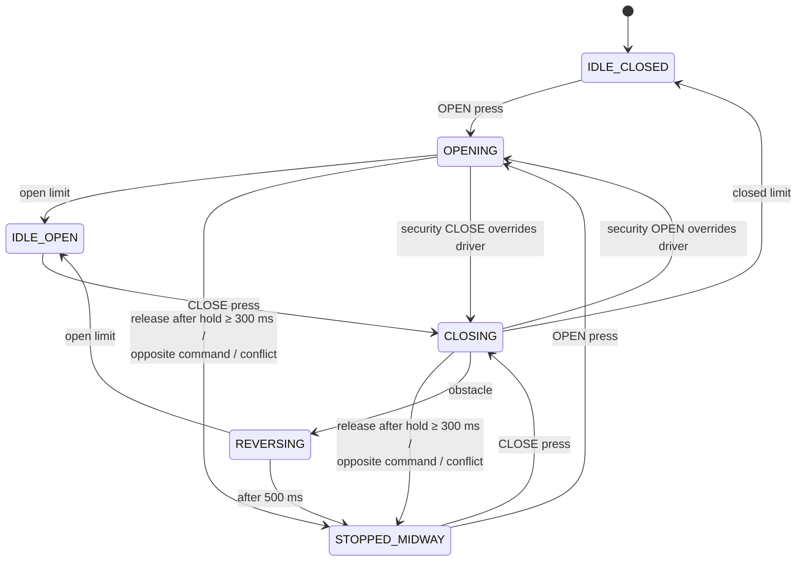

# Smart Parking Gate — FreeRTOS on TM4C123

A garage gate controller for the TI Tiva C LaunchPad (TM4C123GH6PM) built on FreeRTOS. Five prioritized tasks handle debounced inputs from a driver panel and a security panel, limit switches, and an obstacle sensor. They drive a six-state gate state machine with safety reversal.

<!-- TODO: add a 30-second demo video or GIF here, e.g. docs/demo.gif -->

## Features

- **Two control panels:** driver (LaunchPad SW1/SW2) and security (external buttons). Security overrides the driver while the gate is moving.
- **One-touch and hold-to-run:** a press shorter than 300 ms switches to automatic travel to the limit. A longer hold runs the gate only while the button is held and stops it midway on release.
- **Obstacle safety:** an obstacle while closing stops the gate and reverses it for 500 ms, even if CLOSE is still held.
- **Conflict protection:** OPEN and CLOSE pressed together on the same panel stop the gate immediately.
- **Limit switches:** open and closed limits end travel through binary semaphores.
- **Status LEDs:** green while opening or reversing, red while closing.
- **Debug visibility:** every state and mode change is logged over UART, and `g_watch*` variables are exposed for the Keil Watch window and Logic Analyzer.

## Gate state machine



A press released in under 300 ms does not change state. It switches the motion mode from `MOTION_MANUAL` to `MOTION_AUTO`, so the gate keeps moving until it reaches a limit.

## FreeRTOS design

| Task | Priority | Period | Job |
| --- | --- | --- | --- |
| `vSafetyTask` | 5 (highest) | 10 ms | Watches the obstacle input; sends `EV_OBSTACLE` when it triggers while closing |
| `vInputTask` | 4 | 20 ms | Debounces the four panel buttons, detects conflicts, sends press/release events, gives the limit semaphores |
| `vGateControlTask` | 3 | event-driven | Owns the state machine; consumes the event queue and limit semaphores |
| `vLEDTask` | 3 | 30 ms | Sets the red/green LEDs from the current state |
| `vStatusTask` | 2 | 200 ms | Refreshes debug variables and prints the state about once a second |

| Primitive | Type | Used for |
| --- | --- | --- |
| `g_eventQueue` | Queue (24 × `GateEvent`) | Button and safety events → gate control task |
| `g_stateMutex` | Mutex | Protects the shared gate state and motion mode |
| `g_openLimitSem`, `g_closeLimitSem` | Binary semaphores | Limit-switch edges → gate control task |

Each `GateEvent` carries its type, its source (driver or security) and the tick it happened at. The tick is what measures how long a button was held.

## Pin mapping

| Pin | Function | Wiring |
| --- | --- | --- |
| PF4 | Driver OPEN | LaunchPad SW1, active-low, internal pull-up |
| PF0 | Driver CLOSE | LaunchPad SW2, active-low, internal pull-up (unlocked) |
| PE0 | Security OPEN | Active-high, internal pull-down |
| PE1 | Security CLOSE | Active-high, internal pull-down |
| PB0 | Closed limit switch | Active-high, internal pull-down |
| PB1 | Open limit switch | Active-high, internal pull-down |
| PD1 | Obstacle sensor | Active-high, internal pull-down |
| PF1 | Red LED — closing | On-board LED |
| PF3 | Green LED — opening / reversing | On-board LED |

## Build and flash

Requirements: Keil MDK (uVision 5) with the TM4C123 device pack and the FreeRTOS CMSIS pack, and a Tiva C LaunchPad.

1. Open `RTOS project.uvprojx` in uVision.
2. The project references course helper files at `D:\Required_Files\Required_Files\` (`basic_io.c/.h`, `consoleprint.c/.h`, `retarget.c`, `hw_*.h`). Put them at that path, or re-add them from your own location in the Project window.
3. Build (F7), then flash with the on-board ICDI debugger (F8).
4. Open a serial terminal on the LaunchPad's virtual COM port to see the state logs.

To watch the system in the debugger, add `g_watchGateState`, `g_watchMotionMode` and the `g_watchBtn*` variables to Watch 1 or the Logic Analyzer.

## Project layout

```
main.c              Tasks, state machine, GPIO setup
basic_io.h          UART print helpers (implementation in course files)
tm4c123gh6pm.h      TM4C123 register definitions
RTE/                Keil run-time environment: startup, system init, FreeRTOSConfig.h
RTOS project.uvprojx / .uvoptx   Keil project files
```
